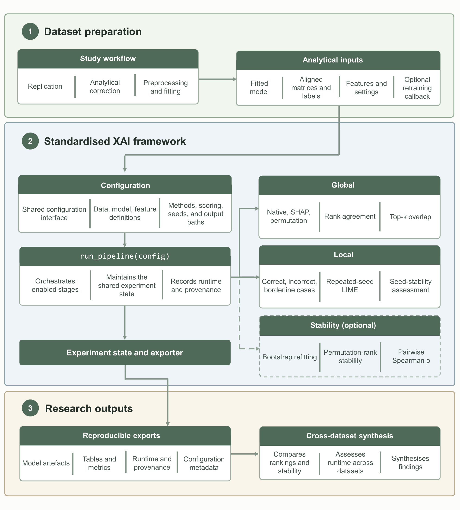

# TRACE-XAI: A Transparent and Reproducible Framework for Auditing Clinical Explanations

This repository contains TRACE-XAI, a reproducible Explainable Artificial Intelligence (XAI) framework developed for the Master’s dissertation *Explainable Artificial Intelligence Applied to Clinical Decision Support Systems* at the University of Minho. It also contains the associated replications and cross-dataset analyses for Heart, Stroke, Diabetes, chronic kidney disease (CKD), and HbA1c-related hospital readmission.

TRACE-XAI provides a standardised workflow for auditing fitted binary clinical prediction models. It integrates native feature importance, permutation importance, SHAP, repeated-seed LIME, representative-case selection, cross-method rank comparison, bootstrap-refit stability analysis, runtime recording, provenance metadata, and reproducible CSV and JSON exports.

The workflow separates three responsibilities:

- **Replication notebooks** reproduce the source-paper analyses and report their results.
- **XAI-extension notebooks** prepare the specified model and data, call TRACE-XAI, and inspect its outputs. Explanation algorithms are implemented in the shared framework rather than copied into each notebook.
- **Predictive uncertainty analysis** evaluates the saved fitted models and test data using the central bootstrap script. Dataset-specific validation notebooks are supplementary analyses, not prerequisites for running TRACE-XAI.

By default, local analysis selects up to 10 observations per available case category and evaluates each observation under 20 LIME perturbation seeds. The standard `run_pipeline(config)` path does not generate the complete predictive-performance report; the separate bootstrap script performs that evaluation.


## Framework architecture



Dataset notebooks retain responsibility for preprocessing, model selection, and fitting. The TRACE-XAI runner accepts the final fitted model and aligned matrices, executes the global and local branches, optionally evaluates bootstrap-refit stability, and exports explanation tables, a fitted bundle, provenance metadata, and stage-level timings.

A direct run uses one configuration dictionary:

```python
from xai_framework.run_pipeline import run_pipeline

config = {
    "dataset_name": "stroke",
    "model": final_model,
    "X_train": X_train_sel,
    "X_test": X_test_sel,
    "y_train": y_train,
    "y_test": y_test,
    "feature_names": list(X_train_sel.columns),
    "scoring": "roc_auc",
    "local_cases_per_type": 10,
    "lime_seeds": list(range(20)),
    "train_model_fn": train_model_fn,
    "stability_n_bootstrap": 100,
    "stability_scoring": "neg_log_loss",
    "output_dir": "../../results/stroke",
}

experiment = run_pipeline(config)
```

The retraining callback is optional. When it is omitted, the same interface produces global and local explanations and records bootstrap-refit stability as unavailable.

## Supported scope

TRACE-XAI currently supports:

- Binary classification with class labels `0` and `1`.
- Scikit-learn estimators.
- The tested statsmodels binary-model adapter.
- NumPy arrays and pandas DataFrames.
- Already-created Patsy design matrices.
- Bootstrap-refit stability when the XAI-extension notebook supplies `train_model_fn`.

It does not claim general support for:

- Regression.
- Multiclass classification.
- Arbitrary statsmodels formulas.
- Untrusted serialized model files.
- Clinical validation or clinical decision-making.

## Reproducible environment

The final tested environment is Windows CPython 3.12.6.

Create and activate a dedicated virtual environment from the repository root:

```powershell
py -3.12 -m venv .venv
.\.venv\Scripts\Activate.ps1
```

Install the exact XAI dependency lock and the framework:

```powershell
python -m pip install --upgrade pip
python -m pip install -r requirements-xai-lock.txt
python -m pip install -e . --no-deps
```

If PowerShell prevents activation, the environment’s Python executable can be used directly:

```powershell
& ".\.venv\Scripts\python.exe" -m pip install --upgrade pip
& ".\.venv\Scripts\python.exe" -m pip install -r requirements-xai-lock.txt
& ".\.venv\Scripts\python.exe" -m pip install -e . --no-deps
```

The dependency files have different purposes:

- `requirements-xai-lock.txt` records the focused, exact XAI runtime and is the recommended installation source.
- `requirements-environment-lock.txt` is the complete archival `pip freeze` of the final Windows interpreter, including unrelated packages. It is retained for provenance rather than normal installation.
- `pyproject.toml` defines the installable package and command-line entry points.

New bundles and CLI manifests record Python, platform, and relevant library versions. Bundles created before this functionality was added cannot acquire missing provenance retroactively.

## Project structure

```text
data/                         dataset inputs
src/replication/              *_replication.ipynb: source-paper reproduction
src/validation/               *_validation.ipynb: supplementary evaluations
src/xai_extension/            *_xai_extension.ipynb: model preparation and framework calls
src/xai_framework/            reusable XAI implementation
src/xai_framework/configs/    bundle-based CLI configurations
src/analysis/                 bootstrap script and cross-dataset analysis
tests/                        unit and integration tests
results/<dataset>/            canonical XAI outputs and model/data bundle
results/uncertainty/           predictive metrics and bootstrap intervals
results/cross_dataset/         combined analysis tables
results/cli_runs/              independent bundle-based reruns
examples/                     optional examples
archive/                      superseded notebooks, figures, and sensitivity runs
main.py                       multi-dataset bundle rerun orchestrator
mybib.bib                     thesis bibliography
```

Use the five `*_replication.ipynb` notebooks and the five
`*_xai_extension.ipynb` notebooks. The original combined `*_paper.ipynb`
files and earlier prototypes have been moved to `archive/legacy_notebooks/`;
they are retained for provenance and are not additional execution steps.

The active analysis notebook is
`src/analysis/xai_results_analysis.ipynb`. Earlier analysis notebooks are
retained under `archive/legacy_notebooks/analysis/` and are not additional
execution steps.

The active Diabetes and CKD YAML files use `roc_auc` for global permutation
importance. Historical `*_neg_log_loss.yaml` and suffixed `*_roc_auc.yaml`
files are retained under
`archive/sensitivity_configurations/scorer_comparison/`; they document the
scoring review and are not additional canonical datasets.

### Notebook conventions

The active replication, validation, XAI-extension, and cross-dataset notebooks follow the same maintenance conventions:

- Imports are consolidated in the first executable code cell.
- Reusable helper functions include concise docstrings.
- Code comments explain non-obvious analytical decisions and appear on the line above the relevant code.
- Interpretive findings and limitations are recorded in Markdown rather than embedded as code comments.
- Stored outputs are retained as evidence of the reported run; after changing executable code, restart the kernel, run all cells, and save the notebook before treating it as a new canonical result.

## Canonical workflow

Use the thesis Python environment for every notebook. Start each notebook with its containing folder as the kernel working directory so that `../../data/`, `../../results/` and `../xai_framework/` resolve correctly. Restart the kernel, run all cells, and save the executed notebook.

### 1. Run the paper replications

Run these notebooks in `src/replication/`:

```text
heart_replication.ipynb
stroke_replication.ipynb
diabetes_replication.ipynb
ckd_replication.ipynb
hba1c_replication.ipynb
```

They preserve the source analyses and their implementation choices. Test rankings are descriptive and do not automatically select a different XAI model.

CKD replication also writes `src/replication/ckd_replication_metrics.csv`, used only by its supplementary validation comparison.

### 2. Run the XAI extensions

Run the corresponding five `*_xai_extension.ipynb` notebooks in `src/xai_extension/`. Each independently prepares its model and data, calls `run_pipeline(config)`, checks the returned outputs and exports to `results/<dataset>/`.

| Dataset | Specified model/configuration | SHAP explainer | Explanation scope | Permutation scorer |
| --- | --- | --- | --- | --- |
| Heart | 10-fold L2 logistic regression | `PermutationExplainer` | Held-out observations | ROC-AUC |
| Stroke | Class-balanced logistic regression on training-selected features | `ExactExplainer` | Held-out observations | ROC-AUC |
| Diabetes | Random Forest, 300 trees, five paper-defined features | `TreeExplainer` | Held-out observations | ROC-AUC |
| CKD | Random Forest, 200 trees, split-first preprocessing | `TreeExplainer` | Held-out observations | ROC-AUC |
| HbA1c | Full-cohort statsmodels logistic interaction model | `PermutationExplainer` | In-sample | ROC-AUC |

The scorer controls permutation-importance calculations; it is not a substitute for the predictive evaluation below. The four predictive extensions supply retraining callbacks for explanation stability. HbA1c does not.

The SHAP classes above are the algorithms instantiated by SHAP 0.51.0 for the exported analyses. The framework passes prediction functions for Heart, Stroke and HbA1c to SHAP's automatic interface, so those analyses are not `LinearExplainer` or `KernelExplainer` runs. New bundle metadata records the instantiated class under `shap_explainer_class`.

The local-analysis settings are explicit in each notebook: `local_cases_per_type=10`, `lime_seeds=range(20)`, five retained rules, and top-three seed-agreement comparison. The framework exports the selected observations to `representative_cases.csv`, every seed-specific explanation to `lime_explanations.csv`, category-level rule summaries to `lime_summary.csv`, and per-observation seed-agreement measures to `lime_seed_stability.csv`. If an outcome category contains fewer than ten observations, all available observations are used.

### 3. Run predictive metrics and bootstrap uncertainty

After the XAI exports exist, run from the repository root:

```powershell
python src/analysis/bootstrap_model_uncertainty.py
```

Without activating the environment:

```powershell
& ".\.venv\Scripts\python.exe" src/analysis/bootstrap_model_uncertainty.py
```

The script reads `model.pkl`, `X_test.csv` and `y_test.csv` from `results/<dataset>/bundle/` for Heart, Stroke, Diabetes and CKD. Use the trusted environment compatible with those saved models. It evaluates the exact models exported by the XAI extensions, not every candidate from replication.

It reports Accuracy, Precision, Recall, Specificity, F1, ROC-AUC and average precision (stored under `PR_AUC`), with 95% percentile bootstrap intervals. Defaults are 5,000 resamples and seed 42. These intervals describe test-sample uncertainty conditional on the fitted model; the script does not retrain models or quantify training variability.

Outputs are written to `results/uncertainty/`:

```text
bootstrap_metrics_long.csv       numeric estimates and interval bounds
bootstrap_metrics_table.csv      formatted comparison table
bootstrap_metrics_table.tex      LaTeX table
bootstrap_run.json               sampling settings and test-set counts
images/results/bootstrap_roc_auc.pdf  ROC-AUC interval figure used in the thesis
```

HbA1c is excluded because the replicated design has no held-out test partition.

### 4. Run cross-dataset analysis

Restart and run `src/analysis/xai_results_analysis.ipynb` from `src/analysis/`.

It reads the current XAI exports and `results/uncertainty/bootstrap_metrics_long.csv`, generates comparison plots, and writes combined tables to `results/cross_dataset/`. HbA1c explanations are explicitly labelled in-sample and excluded from predictive-performance charts. Save the executed notebook. Plot display does not itself export image files; save the required figures explicitly for use in LaTeX.

### Supplementary validation notebooks

The notebooks in `src/validation/` are optional for the main workflow:

- **CKD:** compares paper-style preprocessing before the split with split-first preprocessing. Run CKD replication first; its CSV must be read as `Path("../replication/ckd_replication_metrics.csv")`.
- **Heart:** isolates the existing logistic-regression evaluation.
- **Stroke:** compares unweighted logistic-regression configurations with the balanced extension model.
- **Diabetes:** compares Random Forest feature configurations using the existing metrics.
- **HbA1c:** records why held-out predictive validation is not applicable; it does not run another model.

These notebooks do not provide a new independent test cohort. The main validation chapter can use the central bootstrap outputs, with the CKD comparison or other supplementary comparisons included where relevant.

### Optional Heart demonstration

`examples/heart_demo.py` is a small bundle-based demonstration for readers who
want to inspect the framework without rerunning the complete notebook workflow.
It is not part of the canonical result-generation sequence and does not replace
the Heart replication or XAI-extension notebooks.

After the canonical Heart bundle has been generated, validate it with:

```powershell
python examples/heart_demo.py
```

To rerun the trusted saved model and print a concise summary of its global and
local explanations, use:

```powershell
python examples/heart_demo.py --run
```

The demonstration writes to a new timestamped directory under
`results/cli_runs/` and does not overwrite `results/heart/`. It does not rerun
bootstrap-refit stability because the saved bundle does not contain the
notebook retraining callback.

### Execution order and thesis presentation

The main execution order is **replication → XAI extensions → bootstrap evaluation → cross-dataset analysis**. XAI currently exports the model/data bundles needed by the bootstrap script. This file dependency does not require presenting XAI before validation in the thesis: the chapters can remain **Replication → Validation → XAI**.

For framework changes or a final reproducibility check, run the automated tests below. Bundle CLI and batch reruns are optional independent checks, not replacements for training in the extension notebooks.

## Tests

Activate the project environment and run the complete suite:

```powershell
python -m pytest tests -v --run-integration
```

If the environment is not activated, use its Python executable directly:

```powershell
& ".\.venv\Scripts\python.exe" -m pytest tests -v --run-integration
```

The suite includes a small real SHAP/LIME integration pipeline.

Install the development tools and reproduce the statement-coverage report with:

```powershell
python -m pip install -r requirements-dev.txt
python -m coverage run -m pytest tests -q --run-integration
python -m coverage report -m
python -m coverage json -o docs/verification/coverage.json
```

The latest measured run contained 62 passing tests, completed in 119.78 seconds, and achieved 82% statement coverage (a separate branch-enabled run achieved 78%) over `src/xai_framework`. The full report is retained under `docs/verification/`.

The tests cover:

- Binary metric calculation.
- Task detection.
- Model selection.
- Native importance extraction.
- Feature alignment.
- Rank comparison and tie handling.
- Representative-case selection.
- CSV and JSON exports.
- Bundle round trips.
- Pipeline execution order.
- Runtime provenance.
- Result comparison.
- Batch validation and orchestration.
- A small real SHAP/LIME pipeline.
- Canonical ROC-AUC configuration for Diabetes and CKD.
- CKD identifier, exact-duplicate, and cross-partition profile integrity checks.

Passing tests support only the documented and tested scope. They are not clinical validation or proof of statistical explanation fidelity.

Every pipeline run now writes `execution_times.json` and embeds the same stage-level timing record in `bundle/metadata.json`. The record separates global explanation, repeated local explanation, optional stability, export, and total execution time. Timings depend on the data, model, explainer, settings, hardware, and concurrent system workload.

A saved-bundle benchmark is retained in `docs/verification/execution_times.csv` and documented in `docs/verification/execution_benchmark.md`. On the measured Windows 11/CPython 3.12.6 workstation, total times were 52.7 s (Heart), 31.6 s (Stroke), 221.4 s (Diabetes), 90.0 s (CKD), and 2,211.5 s (HbA1c). These single-run measurements exclude model fitting and bootstrap-refit stability.

## Bundle CLI

The package can be executed with:

```powershell
python -m xai_framework
```

If the virtual environment is not activated, use:

```powershell
& ".\.venv\Scripts\python.exe" -m xai_framework
```

CLI configurations are parsed using YAML safe loading, and unsupported configuration keys are rejected. Validation checks the CSV/JSON schema, row counts, finite numerical values, binary labels, and ordered feature alignment. Configuration paths are resolved relative to the project root defined by the YAML rather than the shell's current directory. `base.yaml` is a copyable template and is not automatically merged into dataset configurations. An optional dataset-level `scoring` value overrides the scorer stored in bundle metadata; when omitted, the saved experiment scorer is preserved.

### Validate a bundle

Validate a trusted saved bundle without deserializing its model:

```powershell
python -m xai_framework `
  --config src/xai_framework/configs/heart.yaml `
  --validate-only
```

Validation checks the saved CSV and JSON data, feature order, labels, configuration, and expected bundle structure.

Validation does not load the model or verify predictions.

### Rerun XAI from a bundle

Rerun the XAI pipeline using the fitted model stored in the bundle:

```powershell
python -m xai_framework `
  --config src/xai_framework/configs/heart.yaml `
  --trust-model
```

Pickle and joblib files can execute code while loading. Use `--trust-model` only for bundles that you created and control.

The configured output path contains a UTC `{timestamp}`, so every execution receives a new output directory. Canonical results are not overwritten.

Validation and execution performed as separate commands display different prospective output timestamps. This is expected.

### CLI limitations

The bundle CLI:

- Does not retrain models.
- Cannot reproduce repeated-fit stability because bundles do not serialize `train_model_fn`.
- Preserves statsmodels design columns.
- Validates data and feature order.
- Checks LIME representative-case coverage.
- Writes a `cli_run.json` manifest with runtime provenance.

Warnings that a scikit-learn estimator was fitted without feature names can occur when a saved estimator was originally fitted with a NumPy array and is later evaluated using an equivalent DataFrame. These warnings should be reviewed, but they do not necessarily indicate a failed run.

## Result comparison

Canonical CSV exports can be compared with an independent CLI rerun using numerical tolerances:

```powershell
python -m xai_framework.compare_results `
  --reference results/heart `
  --candidate results/cli_runs/heart_YYYYMMDDTHHMMSSZ `
  --output results/comparisons/heart.json
```

Custom tolerances can be supplied when justified:

```powershell
python -m xai_framework.compare_results `
  --reference results/heart `
  --candidate results/cli_runs/heart_YYYYMMDDTHHMMSSZ `
  --atol 0.0005 `
  --rtol 0.005 `
  --output results/comparisons/heart_with_tolerance.json
```

Comparison statuses are:

- `EXACT`: text and numerical values match exactly.
- `CLOSE`: numerical values match within the configured tolerances.
- `DIFFERENT`: at least one comparable value exceeds the tolerances.
- `SCHEMA_DIFFERENT`: table columns differ.
- `SHAPE_DIFFERENT`: table dimensions differ.
- `MISSING`: a compared file is absent from one side.

SHAP and LIME results can vary slightly across executions. Differences must be reviewed rather than automatically increasing tolerances until a report passes.

The comparison covers exported CSV tables. It does not prove model equivalence, statistical explanation validity, or clinical validity.

## Batch orchestration

The root `main.py` validates and reruns multiple saved bundles through one command.

### Validate all datasets

Validate all five saved bundles without loading their serialized models:

```powershell
python main.py validate
```

Without an activated environment:

```powershell
& ".\.venv\Scripts\python.exe" main.py validate
```

### Run all datasets

Run all five trusted bundles and compare the generated results with the canonical results:

```powershell
python main.py run --trust-models --compare
```

Without an activated environment:

```powershell
& ".\.venv\Scripts\python.exe" main.py run --trust-models --compare
```

### Run selected datasets

Validate selected datasets:

```powershell
python main.py validate --datasets heart diabetes
```

Run and compare selected datasets:

```powershell
python main.py run `
  --datasets heart diabetes `
  --trust-models `
  --compare
```

### Batch outputs

Each batch receives a UTC timestamp and writes to:

```text
results/cli_runs/batches/batch_YYYYMMDDTHHMMSSZ/
  batch_manifest.json
  heart/
  stroke/
  diabetes/
  ckd/
  hba1c/
  comparisons/
```

The batch runner:

- Validates every selected bundle before loading any model.
- Refuses to overwrite an existing batch directory.
- Does not overwrite canonical results.
- Stops on the first execution failure by default.
- Preserves partial output after failures or interruptions.
- Records dataset progress and outcomes in `batch_manifest.json`.
- Can continue to later datasets with `--continue-on-error`.

A dataset marked `PASSED` completed its pipeline execution successfully. This does not necessarily mean that every generated file exactly matched the canonical version. The corresponding comparison report must still be inspected for `EXACT`, `CLOSE`, or `DIFFERENT` results.

Small numerical SHAP differences can exchange the order of nearly tied features. For example, a maximum rank difference of one can occur even when the underlying mean absolute SHAP values differ only by a few millionths.

The batch runner does not train models or reproduce repeated-fit stability. The HbA1c bundle contains approximately 70,000 test observations, and its SHAP execution can take approximately 30 minutes.

## Adding another dataset

To add another dataset:

1. Reproduce the source study in a replication notebook and document the model/configuration used for the extension.
2. Add an XAI-extension notebook that prepares aligned `X_train`, `X_test`, `y_train` and `y_test` objects with unique, ordered feature names.
3. Supply the fitted binary model, scoring name, output directory and optional `train_model_fn` to `run_pipeline`.
4. Run the extension successfully and inspect its canonical outputs and bundle.
5. Add unit fixtures and an integration test appropriate to the model family.
6. Add a dataset YAML file only after a successful canonical bundle exists, then add it to the batch configuration.
7. Extend bootstrap evaluation only when the dataset has an appropriate held-out design.
8. Extend the cross-dataset analysis without silently changing established definitions.

## Outputs

XAI dataset outputs can include:

- A reproducibility bundle.
- Native model importance.
- Permutation importance.
- SHAP importance.
- Rank-comparison tables.
- Agreement summaries.
- Representative cases.
- LIME explanations.
- Stability summaries when a retraining callback is available.
- Runtime and dependency metadata.

Canonical XAI-extension outputs are stored under:

```text
results/<dataset>/
```

Independent CLI outputs are stored under:

```text
results/cli_runs/
```

Cross-dataset analysis outputs are stored under:

```text
results/cross_dataset/
```

Predictive evaluation outputs are stored separately under `results/uncertainty/`. Replication tables and figures remain in the executed replication notebooks unless explicitly exported.

Generated results, serialized models, caches, editable-install metadata, and local virtual environments remain excluded from version control.

## Methodological limitations

TRACE-XAI and the associated analyses have several important limitations:

- Raw importance magnitudes are not directly comparable across different XAI methods.
- Rank agreement measures ordering similarity rather than equality of explanation meaning.
- Representative cases are descriptive selections, not a population sample.
- Global/local overlap is based on lexical feature presence and is not formal SHAP–LIME agreement.
- LIME explanations are local surrogate approximations.
- Permutation importance depends on the selected evaluation data and scoring metric.
- SHAP values can vary slightly due to explainer behavior, sampling, software versions, and numerical precision.
- Repeated-fit stability is available only when the XAI-extension notebook supplies a retraining callback; it measures explanation variability, not bootstrap predictive uncertainty.
- Bundle-based reruns evaluate an existing fitted model and do not repeat model selection.
- HbA1c explanations refer to Patsy design terms and interactions rather than only raw clinical variables. The same full cohort supplies reference and explanation data; scores and explanations are in-sample and are not equivalent to held-out predictive results.
- The exploratory HbA1c grouped-permutation bootstrap completed 58 of 100 converged refits. Its stability correlation is excluded from the canonical comparison because discarding 42 failed fits could introduce selection bias.
- Diabetes has five features, so top-five set overlap is automatically complete when all methods cover the feature set; this alone does not establish ranking agreement.
- Bootstrap intervals are conditional on each fitted model and do not incorporate retraining or model-selection uncertainty.
- The framework does not establish causal relationships or clinical utility.

## Reproducibility record

For the final thesis archive, retain:

- The final Git commit identifier.
- `requirements-xai-lock.txt`.
- `requirements-environment-lock.txt`.
- `pyproject.toml`.
- The five executed replication notebooks.
- The five executed XAI-extension notebooks.
- Supplementary validation notebooks used in the thesis, including the executable CKD duplicate-integrity checks.
- The bootstrap script, uncertainty tables and `bootstrap_run.json`.
- The executed cross-dataset analysis notebook.
- Canonical dataset results.
- Selected batch manifests and comparison reports.
- Python and library versions recorded in bundle metadata.
- Any institutionally required thesis deposit files.

Timestamped CLI and batch outputs are reproducibility evidence. They should not automatically replace the canonical notebook-generated thesis results.

## Citation and license

See `mybib.bib` for source-paper and software citations. The original TRACE-XAI software in this repository is released under the MIT License; see `LICENSE`. Third-party datasets, source publications, and other external materials remain subject to their respective access and reuse terms and are not relicensed by this repository.

The MIT License applies to the original source code under `src/`, `examples/`, `tests/`, and the repository-level Python utilities. It does not by itself license the dissertation manuscript, third-party datasets, or externally sourced material; those remain subject to their applicable copyright and institutional terms.

## Archival release

Version **1.0.0** of TRACE-XAI is archived on Zenodo:

**DOI:** [10.5281/zenodo.23699962](https://doi.org/10.5281/zenodo.23699962)

When using TRACE-XAI, please cite the archived software release and the associated Master’s dissertation.
